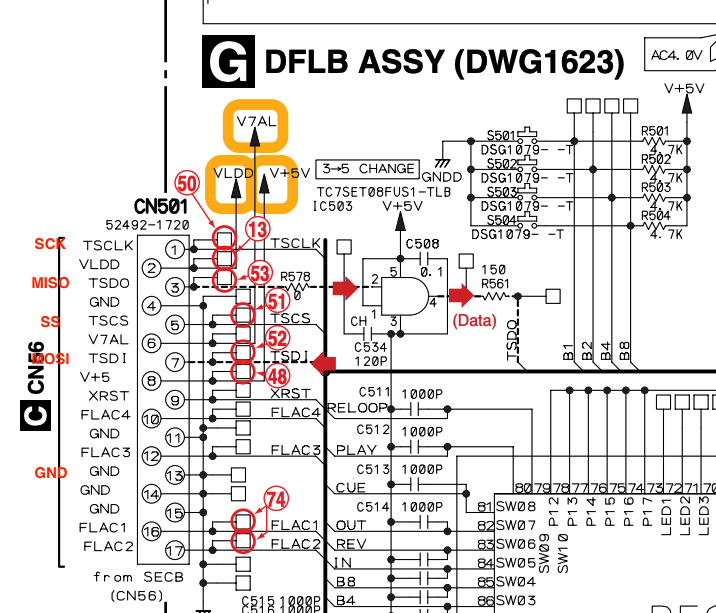

# CDJ800SPI — Pioneer CDJ-800MK2 panel for Arduino

An Arduino SPI slave library for the CDJ-800MK2 display, lights and inputs,
based on the panel protocol recovered from the original E02 firmware binaries.

**The Arduino implementation, examples, documentation and tests in this
reconstruction were generated with AI from analysis of those firmware binaries.
This implementation has not been tested on real hardware.** Successful builds
and software tests do not establish that it works with a physical CDJ panel.

If you try it, please [open an issue with your results](https://github.com/AlejandroPerez92/cdj800spi/issues/new?template=hardware-test.md),
whether it works fully, partly or not at all. Include your board and panel
model, wiring, commit, working/failing controls, error counters and any serial
logs or logic analyzer captures. Hardware feedback will help verify the
protocol assumptions and improve the driver.

## Features and supported boards

- Nine-character text using the original glyphs, track number, BPM and tempo.
- Button indicators, VINYL, MASTER TEMPO, QUICK RETURN and WIDE.
- Jog display, a 33-segment progress bar and up to ten cue markers.
- All 27 buttons, press/release events, and raw pitch/jog input fields.
- Fixed memory, coherent six-frame output and SS-based framing recovery.
- A serial input demo and a MIDI controller example for Arduino Uno.

The panel generates SCK and SS. Arduino replaces the MAIN/FPGA end as an
**SPI slave, mode 3, MSB first**. The AVR adapter supports classic Uno/Nano
ATmega328P/168 and Mega ATmega2560/1280 boards. It does not support Uno R4,
Nano Every or the CDJ-800 MK1 panel.

The service manual specifies **TSCLK at 1 MHz**. The current Uno transport
relies on gaps between bytes and chip selections; it does not sustain a
continuous 1 MHz stream. Actual panel timing remains unverified.

## Getting started

The reusable library lives in [lib/CDJ800SPI](lib/CDJ800SPI). See its
[API and usage guide](lib/CDJ800SPI/README.md) for installation, supported
ranges, synchronization and provisional input interpretations.

With PlatformIO, build and upload the panel demo:

```sh
pio run -e uno
pio run -e uno -t upload
pio device monitor
```

For Mega, use `pio run -e mega2560`. Both environments compile the distributed
[PanelDemo](lib/CDJ800SPI/examples/PanelDemo/PanelDemo.ino) sketch. The library
installs its interrupt handlers; remove any old `ISR(SPI_STC_vect)` from your
sketch. Original names such as `Cdj`, `init()` and `lastStatus()` remain available.

The demo prints inputs at **115200 baud**: named button press/release events,
pitch/touch/jog values, the complete raw frame and error counters. Changed
analog values are summarized up to ten times per second. Serial output drains
without waiting in `loop()`; UART interrupts still consume CPU time.

For Arduino IDE, copy `lib/CDJ800SPI` into your libraries folder, or generate
an installable ZIP with `python3 tools/package_library.py`. Open
`File > Examples > CDJ800SPI > PanelDemo` after installing it.

## MIDI controller on Uno

Upload [MidiController](lib/CDJ800SPI/examples/MidiController/MidiController.ino):

```sh
pio run -e uno_midi -t upload
```

On channel 1, the 27 buttons send notes 36..62, pitch sends absolute CC 20,
and the jog sends relative CC 22. The hardware UART runs at 31250 baud for
DIN MIDI or USB MIDI with [HIDUINO](https://github.com/ddiakopoulos/hiduino)
installed on the Uno's ATmega16U2/8U2 USB chip. The same USB connector can then
appear as a standard MIDI device. HIDUINO changes the usual sketch-upload
workflow; the [MIDI guide](lib/CDJ800SPI/examples/MidiController/README.md)
explains this, wiring, MIDI Learn, pitch calibration and the alternative
computer serial-to-MIDI bridge. Display and light feedback is local.

## Wiring

Disconnect MAIN at CN301 before connecting Arduino. Use CN501 on DFLB and
keep the panel's own power supply. Do not connect two slaves driving MISO
at the same time.



| CN501 | Uno / classic Nano | Mega | Signal |
|---|---|---|---|
| 1 | 13 | 52 | SCK |
| 3 | 12 | 50 | MISO |
| 5 | 10 | 53 | SS |
| 7 | 11 | 51 | MOSI |
| 14 | GND | GND | GND |

The panel link uses 5 V logic. A 3.3 V port requires level conversion and a
suitable hardware SPI slave peripheral.

## Software checks

From the repository root, with Python 3 and Clang installed:

```sh
python3 test/test_arduino_library.py -v
python3 test/test_midi_example.py -v
```

These tests compile the real portable library with AddressSanitizer and
UndefinedBehaviorSanitizer. They cover checksums, display fields, framing,
coherent publication, input events, queue overflow and MIDI messages. They
run without the original firmware binaries or decompilation files. The
included flash tables are already sufficient to build the library.

For AVR builds, use `pio run -e uno -e mega2560 -e uno_midi`. If your host cannot
execute PlatformIO's AVR toolchain, `sh tools/build_arduino_docker.sh` runs the
same builds in a Linux container. See the
[Arduino integration notes](docs/arduino-library.md) for protocol details and
validation limits. Real panel timing, physical orientation and provisional
input/indicator identities still need hardware testing.

The project started from [DjFix/spi-spy](https://github.com/DjFix/spi-spy).
